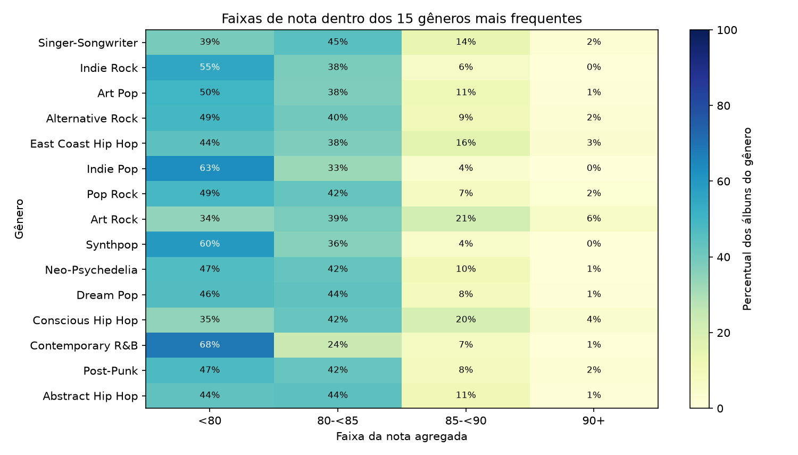
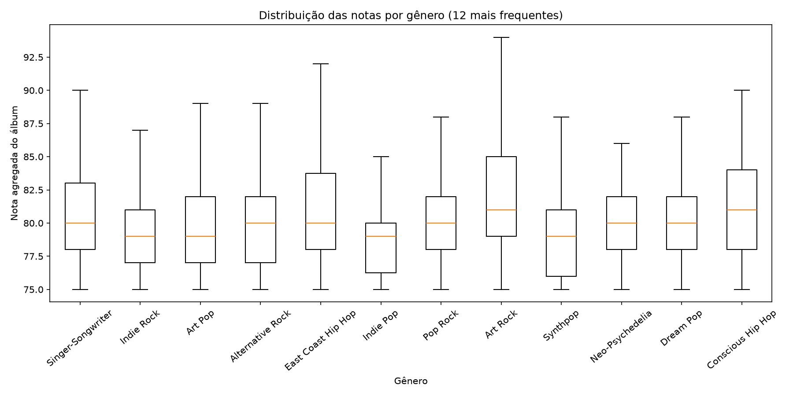
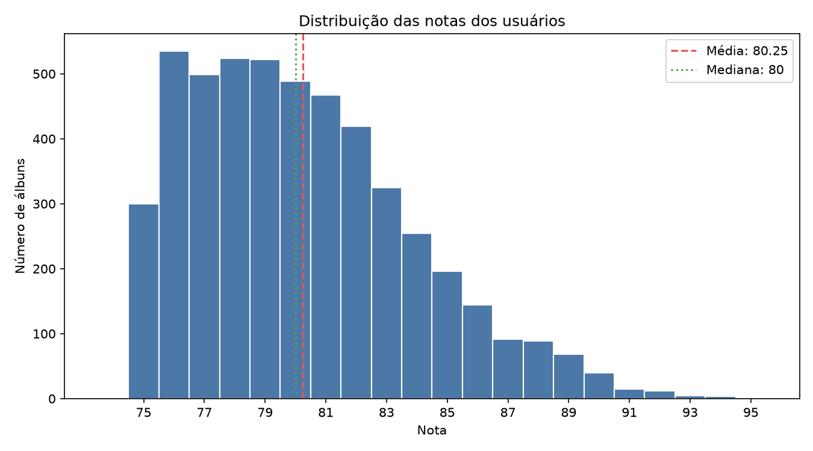
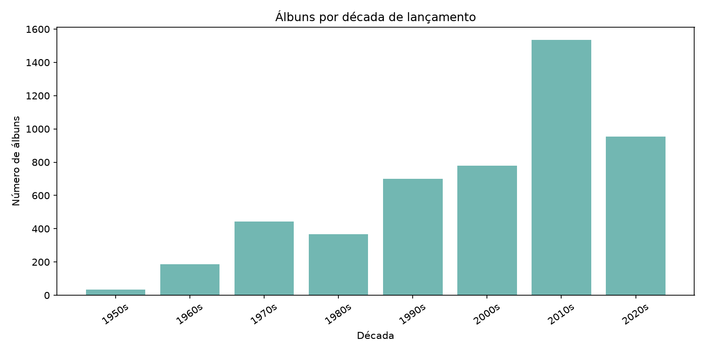
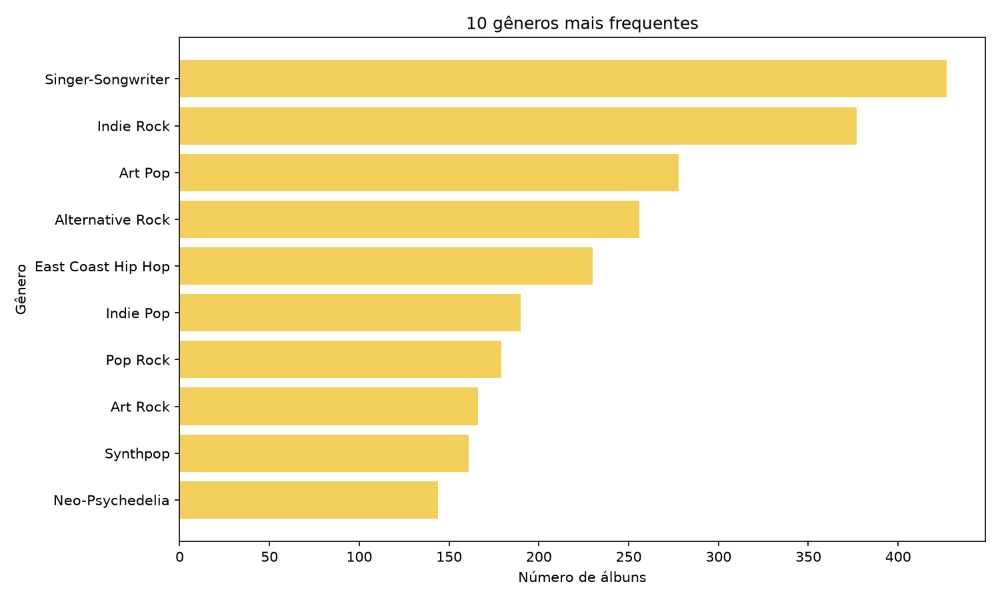
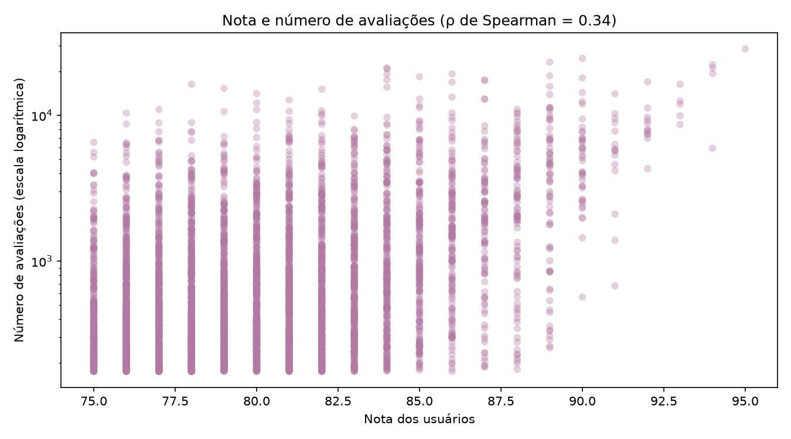

# Relatório de análise exploratória — Album of the Year

## Visão geral

- Registros: **5,000**
- Colunas originais: **8**
- Células vazias nas colunas originais: **0**
- IDs duplicados: **0**
- Links duplicados: **0**
- Intervalo de anos de lançamento: **1954–2024**

## Principais resultados

- Nota média: **80.25**; mediana: **80.0**; intervalo observado: **75–95**.
- Avaliações por álbum: mediana de **482** e média de **1,255**.
- Artista com mais álbuns no conjunto: **King Gizzard & The Lizard Wizard** (15 álbuns).
- Gênero mais frequente: **Singer-Songwriter** (427 ocorrências).
- Correlação de Spearman entre nota e quantidade de avaliações: **0.337**.
- Álbum com mais avaliações: **To Pimp a Butterfly**, de Kendrick Lamar (28,594 avaliações; nota 95).

A correlação descreve uma associação monotônica neste conjunto; não demonstra causalidade. A distribuição também é influenciada pela seleção de álbuns e usuários da fonte.

## Grupos para descoberta por gênero e nota

- Cada álbum é associado a cada gênero informado (um álbum com vários gêneros aparece em vários grupos) e a uma faixa de nota: `<80`, `80-<85`, `85-<90` ou `90+`.
- Use `albuns_por_genero_faixa_nota.csv` para explorar álbuns de um gênero; dentro de cada grupo, os registros são ordenados por nota e depois por quantidade de avaliações.
- O mapa de calor compara a proporção de notas em cada gênero; os boxplots mostram a distribuição das notas nos gêneros mais frequentes.
- Entre grupos com pelo menos 10 álbuns, as maiores médias de nota foram: **Art Rock (90+)** — média 91.60 em 10 álbuns; **Cinematic Classical (85-<90)** — média 87.73 em 11 álbuns; **Pop Rock (85-<90)** — média 87.15 em 13 álbuns; **Folk Rock (85-<90)** — média 87.08 em 13 álbuns; **Progressive Metal (85-<90)** — média 86.83 em 12 álbuns.
- Esses grupos são uma forma transparente de filtrar candidatos por conteúdo e nota agregada, não clusters aprendidos nem uma probabilidade comprovada de agrado. A confirmação exige histórico e avaliação com usuários.

## Gráficos

## Arquivos tabulares

- `artistas_mais_frequentes.csv` — artistas com mais álbuns.
- `generos_mais_frequentes.csv` — frequência e nota média por gênero.
- `albuns_por_decada.csv` — quantidade de álbuns e nota média por década.
- `grupos_genero_nota.csv` — resumo dos grupos de gênero por faixa de nota.
- `albuns_por_genero_faixa_nota.csv` — álbuns atribuídos aos grupos, ordenados por nota e avaliações.

Datas com formatos variados são interpretadas durante a leitura; a comparação temporal usa apenas o ano extraído.
